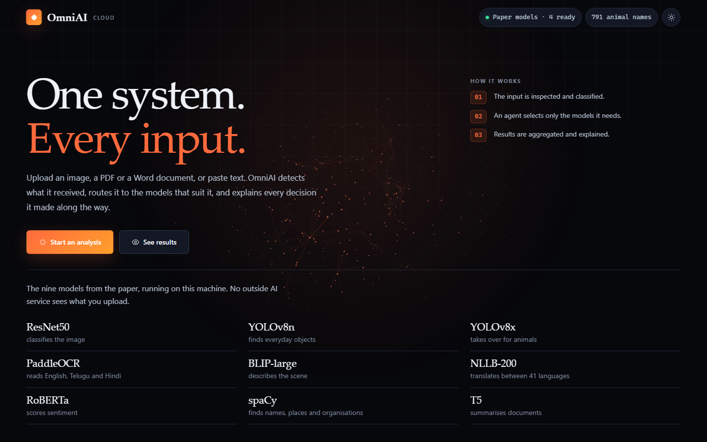
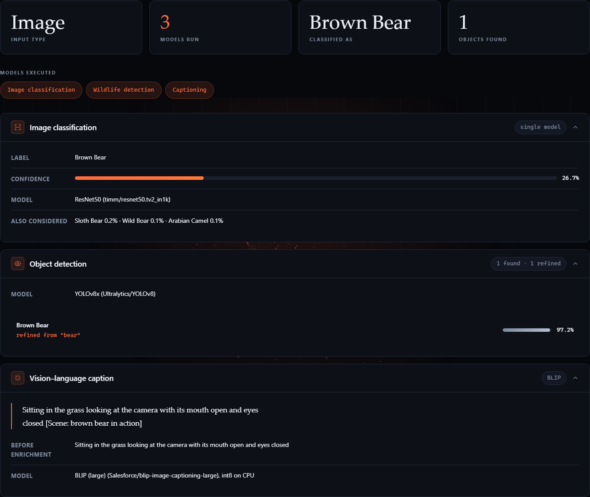
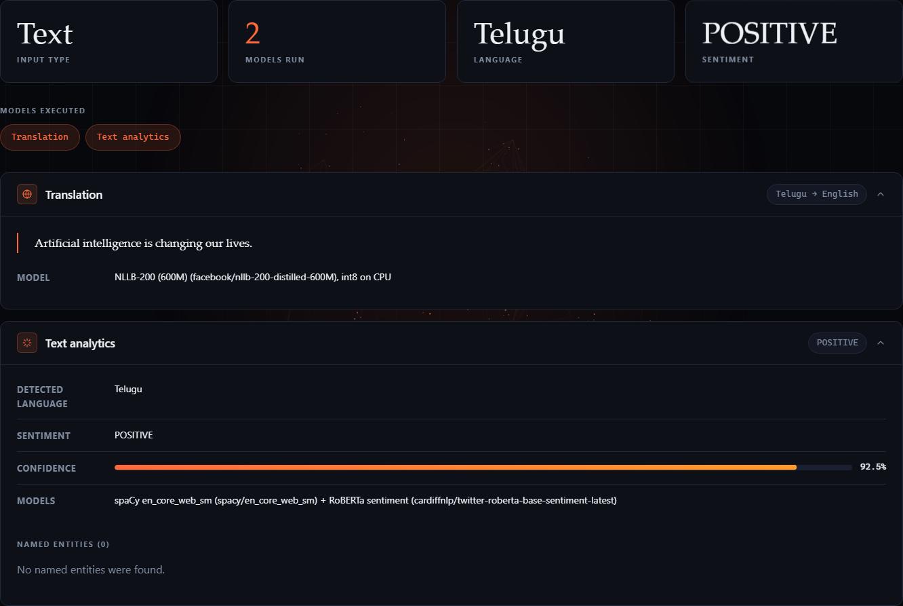
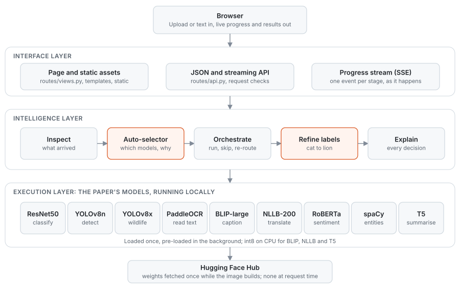
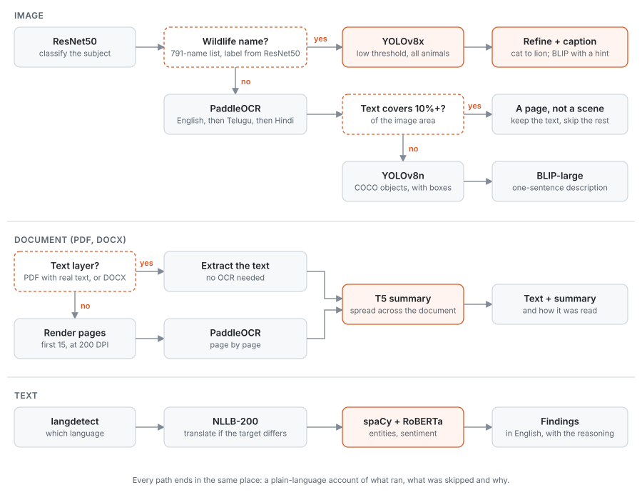
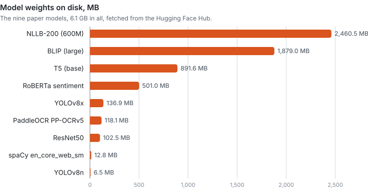
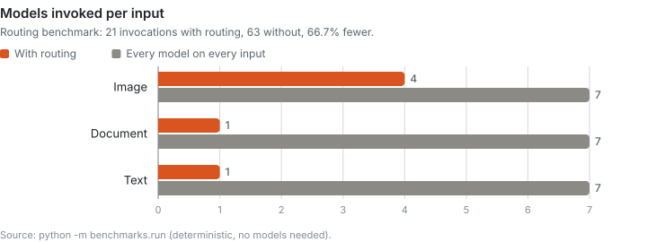
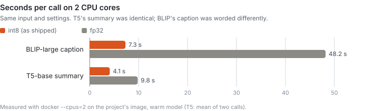
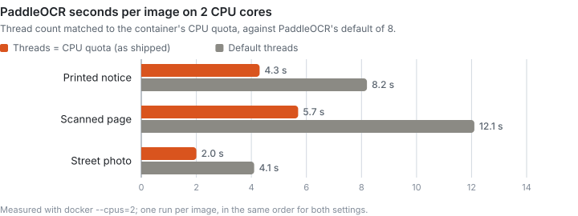

# OmniAI Cloud

**An intelligent unified multi-modal AI system with automatic model selection and explainability.**

Final-year B.Tech project, Department of Artificial Intelligence and Machine Learning,
Sasi Institute of Technology and Engineering. U. Renuka, S. Gopika Devi, K. Akshay and
P. Sunil, under the guidance of Dr. Shaik Mohammad Rafee. Conference paper ICCAIS-029.



---

## The problem

Applying AI to everyday material is still a matter of choosing a model for each job:
one for photographs, another to read a scanned page, another to translate, another
to summarise. Running all of them on everything is slow and produces noise, such as
a caption of a page of text or an object detector run over a paragraph. General
detectors are also vague where it matters: they report "bear" or "bird" where a
wildlife survey needs the species. And few tools say what they actually did with an
input, or why.

OmniAI Cloud takes one input at a time (a photograph, a scanned or digital document,
or text in any of 41 languages), works out what it is, runs only the models from the
paper that suit it, sharpens coarse labels to the species level, and writes down every
decision it made. It runs entirely on your own machine: nothing is sent to an outside
AI service.

## What it produced on real inputs

Every row below is a real run of this repository's image on a laptop, with the models
listed. Nothing was edited, including the mistakes.

| Input | What ran | What came back |
|---|---|---|
| Photograph of a bear ([COCO 285](http://images.cocodataset.org/val2017/000000000285.jpg)) | ResNet50, YOLOv8x, BLIP | Classified "brown bear". The detector's "bear" was refined to "brown bear". Caption: *"Sitting in the grass looking at the camera with its mouth open and eyes closed."* OCR skipped: a wildlife photo carries no text. |
| Two cats on a sofa ([COCO 39769](http://images.cocodataset.org/val2017/000000039769.jpg)) | ResNet50, PaddleOCR, YOLOv8n, BLIP | Found 2 cats, 2 remotes, 1 couch, with boxes. Caption: *"This is a picture of two cats laying on a couch with remote controls in their paws and one lying on its back."* |
| London bus ([COCO 1584](http://images.cocodataset.org/val2017/000000001584.jpg)) | ResNet50, PaddleOCR, YOLOv8n, BLIP | Found 3 buses and 4 people. The sign text covers a small part of the photo, so it stayed a scene. OCR read the destination board as *"St Pai's Catedial / Fleet Sont / Aldwych"*: stylised signage is hard. |
| Printed notice, English | ResNet50, PaddleOCR | Read all five lines. Detection and captioning were skipped because the image is a page of text. |
| Printed text, Telugu | ResNet50, PaddleOCR (English, then Telugu) | The English pack was unsure; the Telugu pack read it at 96% confidence: *"కృగతిమ మేధసును మన జీవితాలను మారుస్తోంది"* (two of the five words have a conjunct misread). |
| Scanned two-page PDF | PaddleOCR, T5 | OCR on each page, then a T5 summary: *"OmniAl Cloud is a unified multi-modal system that accepts images, documents and text. It inspects each input, selects only the models that suit it…"* ("OmniAl": OCR read the capital I as a lower-case l). |
| Text: *"The team presented OmniAI Cloud to Dr. Shaik Mohammad Rafee at Sasi Institute of Technology and Engineering in Tadepalligudem…"* | spaCy, RoBERTa | Positive sentiment. People, places and organisations: Shaik Mohammad Rafee (person), Sasi Institute of Technology and Engineering (organisation), Tadepalligudem (place). |
| Text in Telugu: *"కృత్రిమ మేధస్సు మన జీవితాలను మారుస్తోంది."* | NLLB-200, spaCy, RoBERTa | Translated: *"Artificial intelligence is changing our lives."* Then analysed in English. |
| Text in English, target Telugu | NLLB-200 | *"కృత్రిమ మేధస్సు విద్యార్థులు నేర్చుకునే విధానాన్ని మారుస్తోంది."* |





---

## How it works



The paper's three layers are kept as they are described. The **interface layer**
serves the page and streams progress as each stage happens. The **intelligence layer**
decides what runs: it inspects the input, lets the auto-selector choose models, runs
them in order, refines labels and writes the explanation. The **execution layer** is the
paper's nine models, each loaded once and kept in memory.



Three routing decisions do most of the work:

- **Animals re-route.** When ResNet50's label is on the list of 791 animal names,
  detection switches from YOLOv8n to the larger YOLOv8x at a lower threshold, and OCR is
  skipped.
- **Pages are not scenes.** OCR runs before detection. When the text it finds covers 10%
  or more of the image, the image is treated as a page: the text is kept, and object
  detection and captioning are skipped. A photo with a little signage stays a scene.
- **Labels are refined.** COCO has no class for most species, so YOLO calls a lion "cat"
  and a gazelle "cow". The classifier's species replaces the coarse label on the main
  subject, and the result says what changed.

---

## The models

All nine are the models the paper describes, downloaded from the Hugging Face Hub
once, when the image is built. At request time nothing is downloaded.

| Job | Model | Hugging Face repository | Weights | Licence |
|---|---|---|---:|---|
| Classify the image | ResNet50 (torchvision ImageNet V2 weights) | `timm/resnet50.tv2_in1k` | 102.5 MB | BSD-3-Clause |
| Find objects | YOLOv8n | `Ultralytics/YOLOv8` | 6.5 MB | AGPL-3.0 |
| Find animals | YOLOv8x | `Ultralytics/YOLOv8` | 136.9 MB | AGPL-3.0 |
| Read text | PaddleOCR 3, PP-OCRv5 (English, Telugu, Hindi) | `PaddlePaddle/*PP-OCRv5*` | 118.1 MB | Apache-2.0 |
| Describe the scene | BLIP (large) | `Salesforce/blip-image-captioning-large` | 1,879.0 MB | BSD-3-Clause |
| Translate | NLLB-200 (distilled 600M) | `facebook/nllb-200-distilled-600M` | 2,460.5 MB | CC-BY-NC-4.0 |
| Sentiment | RoBERTa | `cardiffnlp/twitter-roberta-base-sentiment-latest` | 501.0 MB | CC-BY-4.0 |
| Names, places, organisations | spaCy `en_core_web_sm` | `spacy/en_core_web_sm` | 12.8 MB | MIT |
| Summarise documents | T5 (base) | `google-t5/t5-base` | 891.6 MB | Apache-2.0 |



Settings follow the thesis appendix: YOLOv8n at confidence 0.20, YOLOv8x at 0.10 for
wildlife, BLIP with an 8-beam search, RoBERTa with the thesis's sentiment calibration.
Summaries use T5, as the conference paper describes; the thesis's hosted Mistral
summariser is still available with `OMNIAI_SUMMARIZER=mistral` and a key.

---

## Measured results

### Routing

`python -m benchmarks.run` checks the routing and label-refinement logic on fixed cases.
It needs no models, so anyone can reproduce it exactly.

| Benchmark | Cases | Passed |
|---|---:|---:|
| Wildlife gate | 11 | 11 |
| Label refinement | 51 | 51 |
| Model routing | 15 | 15 |
| Routing selectivity | 9 | 9 |
| Determinism | 33 | 33 |
| Routing overhead | 1 | 1 |
| **Total** | **120** | **120** |



Of ImageNet's 1,000 classes, 127 route to wildlife detection. Routing itself takes
under a millisecond on average. The benchmark measures these decisions, not how accurate
the models are; see [benchmarks/README.md](benchmarks/README.md).

### Speed on a small CPU

The paper's models are large for a CPU. Three changes, each measured on this project's
image with the container limited to two cores, make them practical:





- **int8 on CPU** for BLIP, NLLB-200 and T5. In side-by-side runs, NLLB-200 and T5
  produced the same text as in full precision, apart from punctuation. BLIP's captions
  were worded differently but described the same scene: *"there are two baseball
  players that are playing a game of baseball in the outfield"* in full precision,
  *"there are two men playing baseball on a field and one has a glove in his hand"* in
  int8. `OMNIAI_QUANTIZE=none` restores full precision.
- **Threads sized to the CPU quota.** Inside a container, Python sees every core on the
  host; PaddleOCR and PyTorch then start more threads than there are CPUs to run them.
- **PaddlePaddle 3.2, not 3.3.** 3.3 breaks PP-OCRv5 on its fast CPU path (oneDNN).
  Without that path a one-page image took 116.9 s and 3.0 GB of memory; with it, on the
  pinned 3.2.2, 4.3 s and 1.4 GB. Both were measured without a core limit.

---

## Run it

### With Docker (recommended)

```bash
docker compose up --build
```

Open <http://localhost:7860>. The first build downloads about 6 GB of model weights into
the image and checks that every model loads and that OCR and detection run; later
builds reuse them.

The defaults suit a laptop that gives Docker about 4 GB: models load when first needed,
one analysis runs at a time, and when a model will not fit, the least recently used
one is unloaded first. Moving between photos and translation then costs the time to
reload a model, instead of running out of memory. On a machine that can give Docker 8 GB or
more, keep every model loaded:

```bash
OMNIAI_MODEL_BUDGET_MB=0 OMNIAI_PRELOAD=all docker compose up --build
```

On Windows, Docker Desktop's memory is set in *Settings, Resources* (or `.wslconfig`
for the WSL 2 engine).

### Without Docker

Python 3.10 to 3.13 (PaddlePaddle publishes no wheels for 3.14):

```bash
pip install torch==2.14.0 torchvision==0.29.0 --index-url https://download.pytorch.org/whl/cpu
```

```bash
pip install -r requirements/paper.txt
```

```bash
python -m backend.models.fetch_paper
```

```bash
python -m backend.main
```

### Other profiles

The paper's models are the `paper` profile. Two others share the same pipeline,
routing and explanations:

| Profile | Models | Use it when |
|---|---|---|
| `paper` | The nine above | You want the system the paper describes |
| `offline` | Substitutes that install on Python 3.14 (DETR, EasyOCR, BERT-NER, DistilBART) | Running natively on Python 3.14 |
| `lite` | A hosted API (Gemini or Mistral) | Serverless hosting; needs a key, and the provider's rate limits apply |

Set it with `OMNIAI_PROFILE`. Left unset, the app picks the most faithful profile whose
packages are installed.

---

## Configuration

Everything is set through environment variables; `.env.example` lists them all.

| Variable | Default | What it does |
|---|---|---|
| `OMNIAI_PROFILE` | automatic | `paper`, `offline` or `lite` |
| `OMNIAI_PRELOAD` | `core` (`all` in the image) | Load models at start-up: `all`, `core` or `none` |
| `OMNIAI_MODEL_BUDGET_MB` | `0` (unlimited) | Memory the models may use before the least recently used is unloaded |
| `OMNIAI_MAX_CONCURRENT` | `2` | Analyses that run at once; more are asked to retry |
| `OMNIAI_OCR_LANGS` | `en` (`en,te,hi` in the image) | PaddleOCR language packs, tried in order |
| `OMNIAI_MAX_OCR_PAGES` | `15` | Pages of a scanned PDF read with OCR; the result says when it stopped early |
| `OMNIAI_QUANTIZE` | `int8` | `none` keeps BLIP, NLLB and T5 in full precision |
| `OMNIAI_SUMMARIZER` | `t5` | `mistral` summarises through the Mistral API instead |
| `OMNIAI_MAX_UPLOAD_BYTES` | 25 MB | Largest accepted upload |
| `OMNIAI_TRUSTED_PROXIES` | `0` | Number of reverse proxies in front of the app |

---

## API

| Method | Path | Purpose |
|---|---|---|
| `GET` | `/` | The interface |
| `GET` | `/api/health` | Status, and how many models are loaded |
| `POST` | `/api/analyze/file` | Analyse an upload; one JSON response |
| `POST` | `/api/analyze/text` | Analyse text; one JSON response |
| `POST` | `/api/analyze/file/stream` | The same, with progress over Server-Sent Events |
| `POST` | `/api/analyze/text/stream` | The same, with progress over Server-Sent Events |

```bash
curl -F "file=@photo.jpg" http://localhost:7860/api/analyze/file
```

```bash
curl -H "Content-Type: application/json" -d '{"text": "Namaste", "target_language": "en"}' http://localhost:7860/api/analyze/text
```

The streaming endpoints send a `progress` event as each stage starts and finishes, then
a final `result` or `failed` event. The page uses them, so its progress reflects the
pipeline rather than a timer.

---

## Project layout

```
backend/
  agent/          input inspection, the auto-selector, the 791-name wildlife list
  core/           pipeline orchestration, label refinement
  modules/        one file per paper model, as in the thesis appendix
  providers/      paper, offline and hosted back ends behind one interface
  routes/         the page and the JSON and streaming API
  static/, templates/
  models/         fetch_paper.py and verify_paper.py
benchmarks/       the routing benchmark
deploy/           server and Hugging Face Space deployment
docs/             architecture, deployment, design system, roadmap, charts
tests/            194 tests; no models needed
```

---

## Tests

```bash
pip install -r requirements/dev.txt
```

```bash
python -m pytest
```

194 tests against a scripted back end, so they need no models and no network. They
cover routing, label refinement, OCR language selection, text chunking for NLLB and
T5, the memory budget, failure handling, request limits, uploads, errors and the
streaming contract. The models themselves are checked where they run: the Docker build
loads each one with the network off and runs OCR and detection on a sample image
(`python -m backend.models.verify_paper`), and fails if any of them cannot.

---

## Deployment

A server needs about 8 GB of memory for every model at once. Oracle Cloud's Always Free
Ampere A1 instance (4 cores, 24 GB) is enough, and `scripts/deploy_oracle.sh` sets one
up with HTTPS. A Hugging Face Space works too, with a PRO subscription. See
[docs/deployment.md](docs/deployment.md).

---

## Documentation

- [docs/architecture.md](docs/architecture.md): layers, request lifecycle, extension points
- [docs/deployment.md](docs/deployment.md): servers, Docker, Oracle Cloud, scaling
- [docs/design-system.md](docs/design-system.md): tokens, type, motion
- [docs/roadmap.md](docs/roadmap.md): what comes next
- [benchmarks/README.md](benchmarks/README.md): what the benchmark establishes
- [docs/charts/](docs/charts/): the scripts that draw the charts and diagrams from measured data

---

## Licence and attribution

Academic project. Each model keeps its own licence, listed in the table above. Two
matter before any commercial use: NLLB-200 is licensed for non-commercial use only,
and Ultralytics YOLO is AGPL-3.0, which requires the source of a network service built
on it to be available.
